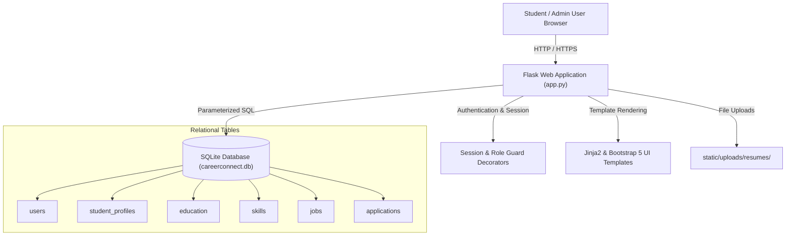
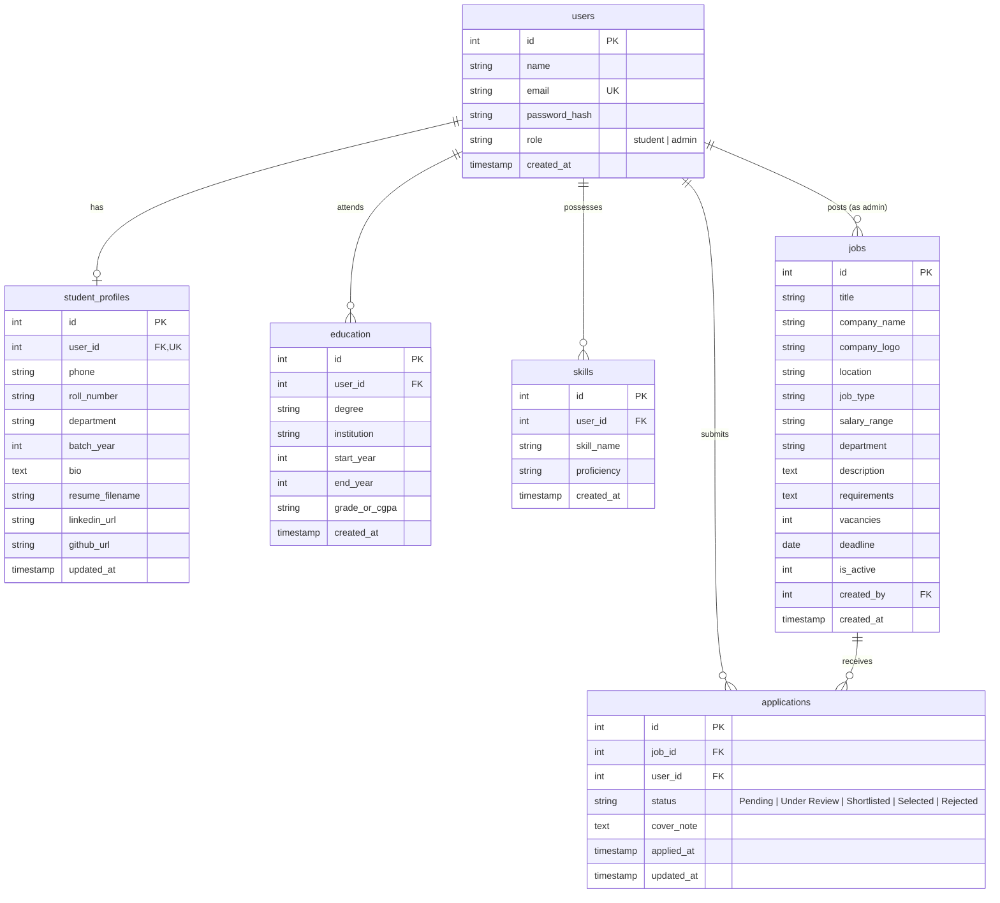

# CareerConnect – Student Placement & Job Portal

[](https://www.python.org/)
[](https://flask.palletsprojects.com/)
[](https://getbootstrap.com/)
[](https://www.sqlite.org/)
[](LICENSE)

**CareerConnect** is a modern, responsive, full-stack campus placement and job recruitment platform. Designed specifically for university training and placement cells (T&P), it unifies student profile management, resume screening, job postings, multi-criteria filtering, and end-to-end job application tracking into an intuitive web portal.

---

## 🌟 Key Features

### 🎓 Student Module
- **Student Registration & Authentication**: Secure sign-up and password hashing with `werkzeug.security`.
- **Dynamic Profile Management**: Update contact info, university roll number, graduating batch, bio, and social handles (LinkedIn & GitHub).
- **Academic Background**: Add, edit, and track multiple education degrees (e.g. B.Tech, Senior Secondary) with institutions, years, and CGPA/percentages.
- **Skills Portfolio**: Showcase technical proficiencies (Beginner, Intermediate, Advanced, Expert) with instant tag management.
- **Resume Upload & Storage**: Securely upload and preview PDF/DOC/DOCX resumes (with server-side validation and sanitization).
- **Placement Drive Discovery**: Browse live placement drives with real-time keyword search and filters by Job Type, Department, and Location.
- **1-Click Application Flow**: Submit personalized cover notes with auto-attached resumes and duplicate application prevention.
- **Application Status Tracking**: Live dashboard status updates (`Pending` ➔ `Under Review` ➔ `Shortlisted` ➔ `Selected` / `Rejected`).

### 🛡️ Admin Module (Placement Cell Desk)
- **Role-based Authentication**: Secure admin console with privileged access control.
- **Executive Analytics Dashboard**: Instant metrics on total active jobs, registered candidates, placement rates, and partner recruiters.
- **Job Postings Management (CRUD)**: Create, preview, edit, toggle active/inactive status, and delete placement drives.
- **Student Candidate Directory**: Search and filter students by department, roll number, or skills count, and view comprehensive dossiers.
- **Recruitment Screening Console**: Filter applications by status or job drive, review student qualifications and cover notes, download student resumes, and update statuses in real-time.

---

## 🛠️ Technology Stack

| Layer | Technologies Used |
|---|---|
| **Frontend** | HTML5, CSS3, Bootstrap 5.3, Bootstrap Icons 1.11, Vanilla JavaScript |
| **Backend** | Python 3.10+, Flask 3.x, Jinja2 Templating Engine |
| **Security** | Werkzeug Security (PBKDF2 Password Hashing, Secure Filename Handling) |
| **Database** | SQLite3 with Foreign Key Constraints & Performance Indexes |
| **Tools & VCS**| VS Code, Git, GitHub |

---

## 🏛️ System Architecture



---

## 🗄️ Relational Database Design

### Entity-Relationship Diagram (ERD)



### Database Tables Breakdown

1. **`users` Table**:
   - `id` (INTEGER, Primary Key, Auto-increment)
   - `name` (TEXT, Not Null): Full name of the student or administrator.
   - `email` (TEXT, Unique, Not Null): Login email address.
   - `password_hash` (TEXT, Not Null): Secure salted hash generated by PBKDF2.
   - `role` (TEXT, CHECK: `'student'` or `'admin'`): Access control discriminator.
   - `created_at` (TIMESTAMP): Account registration timestamp.

2. **`student_profiles` Table**:
   - `id` (INTEGER, Primary Key, Auto-increment)
   - `user_id` (INTEGER, Foreign Key ➔ `users.id`, ON DELETE CASCADE, Unique): 1-to-1 relationship with student user.
   - `phone`, `roll_number`, `department`, `batch_year`, `bio`: Academic & contact metadata.
   - `resume_filename` (TEXT): Secure filename of the uploaded PDF/DOC resume stored in `static/uploads/resumes/`.
   - `linkedin_url`, `github_url`: Professional profile links.
   - `updated_at` (TIMESTAMP): Profile last modified timestamp.

3. **`education` Table**:
   - `id` (INTEGER, Primary Key, Auto-increment)
   - `user_id` (INTEGER, Foreign Key ➔ `users.id`, ON DELETE CASCADE): 1-to-Many relationship.
   - `degree`, `institution`, `start_year`, `end_year`, `grade_or_cgpa`: Academic milestones.

4. **`skills` Table**:
   - `id` (INTEGER, Primary Key, Auto-increment)
   - `user_id` (INTEGER, Foreign Key ➔ `users.id`, ON DELETE CASCADE): 1-to-Many relationship.
   - `skill_name` (TEXT): Programming language, tool, or library (e.g. Python, SQL).
   - `proficiency` (TEXT, CHECK: `'Beginner'`, `'Intermediate'`, `'Advanced'`, `'Expert'`).

5. **`jobs` Table**:
   - `id` (INTEGER, Primary Key, Auto-increment)
   - `title` (TEXT, Not Null): Job title / designation.
   - `company_name` (TEXT, Not Null): Hiring employer.
   - `location` (TEXT, Not Null): Job location (e.g. Bengaluru, Remote).
   - `job_type` (TEXT, CHECK: `'Full-time'`, `'Part-time'`, `'Internship'`, `'Remote'`, `'Contract'`).
   - `salary_range` (TEXT): Package / stipend info (e.g. `₹12,00,000 LPA`).
   - `description`, `requirements`: Detailed job scope and qualification requirements.
   - `vacancies` (INTEGER): Number of positions available.
   - `deadline` (DATE): Closing date for applications.
   - `is_active` (INTEGER): Flag (1 = Open for applications, 0 = Inactive).
   - `created_by` (INTEGER, Foreign Key ➔ `users.id`).

6. **`applications` Table**:
   - `id` (INTEGER, Primary Key, Auto-increment)
   - `job_id` (INTEGER, Foreign Key ➔ `jobs.id`, ON DELETE CASCADE).
   - `user_id` (INTEGER, Foreign Key ➔ `users.id`, ON DELETE CASCADE).
   - `status` (TEXT, CHECK: `'Pending'`, `'Under Review'`, `'Shortlisted'`, `'Selected'`, `'Rejected'`).
   - `cover_note` (TEXT): Statement of purpose or pitch submitted by candidate.
   - `applied_at`, `updated_at`: Application audit timestamps.
   - `UNIQUE(job_id, user_id)`: Prevents multiple duplicate submissions for the same opening.

---

## 📂 Project Structure

```text
c:\python_practice\python_project\
├── app.py                     # Main Flask web application, routing, and controller logic
├── config.py                  # Central configuration (Secret key, upload paths, limits)
├── database.py                # Database connection helper, table init & seed utilities
├── schema.sql                 # Pure SQLite DDL schema with constraints & indexes
├── requirements.txt           # Python dependencies (Flask, Werkzeug, python-dotenv)
├── .gitignore                 # Files excluded from version control
├── README.md                  # Comprehensive documentation and developer manual
├── static/
│   ├── css/
│   │   └── style.css          # Custom styling with Plus Jakarta typography & modern design
│   ├── js/
│   │   └── main.js           # Client validation, auto-dismiss alerts & confirmations
│   ├── uploads/
│   │   └── resumes/           # Secure directory for student resume documents
│   └── images/                # Default illustration & graphic assets
├── templates/
│   ├── base.html              # Master layout with responsive navbar, flash alerts, and footer
│   ├── index.html             # 1. Home Page (Hero, metrics, featured drives, steps)
│   ├── about.html             # 2. About Us Page (Placement mission, FAQs, values)
│   ├── auth/
│   │   ├── signup.html        # 3. Signup Page (Student registration)
│   │   └── login.html         # 4. Login Page (Unified Student & Admin login)
│   ├── student/
│   │   ├── dashboard.html     # 5. Student Dashboard (Personalized stats & recommendations)
│   │   ├── profile.html       # 6. Student Profile (Personal details, education, skills, resume)
│   │   └── applications.html  # 10. My Applications Page (Live status tracker)
│   ├── jobs/
│   │   ├── index.html         # 7. Job Listing Page (Search & multi-criteria filters)
│   │   ├── detail.html        # 8. Job Details Page (Job requirements, eligibility & CTA)
│   │   └── apply.html         # 9. Apply for Job Page (Cover note & resume attachment)
│   └── admin/
│       ├── dashboard.html     # 11. Admin Dashboard (Placement statistics & candidate flow)
│       ├── manage_jobs.html   # 12. Manage Jobs Page (List, toggle, edit, delete jobs)
│       ├── job_form.html      # Create / Edit Placement Drive Form
│       ├── manage_students.html # 13. Manage Students Page (Directory & search)
│       ├── student_detail.html  # Full candidate dossier with academic history & resume
│       └── manage_applications.html # 14. Manage Applications Page (Shortlist, reject, status)
└── tests/
    └── test_portal.py         # 11 automated unit & integration tests
```

---

## 🚀 Quickstart Guide (Step-by-Step)

### Step 1: Clone or Open the Repository
Open your terminal (PowerShell, Command Prompt, or bash) and navigate to the project directory:
```bash
cd c:\python_practice\python_project
```

### Step 2: Install Python Dependencies
Install Flask and required libraries using `pip`:
```bash
python -m pip install -r requirements.txt
```

### Step 3: Initialize and Seed the Database
Initialize the SQLite database and seed it with pre-configured demo users, job postings, and applications:
```bash
python database.py all
```

### Step 4: Run the Application
Launch the Flask development server:
```bash
python app.py
```
Open your browser and navigate to:
👉 **[http://127.0.0.1:5000](http://127.0.0.1:5000)**

---

## 🔑 Demo Login Credentials

The database comes pre-seeded with test accounts ready for instant testing:

| Role | Email Address | Password | Permissions |
|---|---|---|---|
| **Administrator** | `admin@careerconnect.com` | `admin123` | Full access to Admin Console, post/edit jobs, manage students, shortlist/reject applicants |
| **Student (Rahul)** | `rahul@careerconnect.com` | `student123` | Complete CSE profile, education records, skills, applications in review & shortlisted |
| **Student (Priya)** | `priya@careerconnect.com` | `student123` | Information Technology student profile, selected/placed in FinTech Global |
| **Student (Amit)** | `amit@careerconnect.com` | `student123` | Electronics & Comm student profile |

---

## 🧪 Running Automated Tests

Run the test suite verifying authentication, access security, job applications, and admin operations:
```bash
python -m unittest tests/test_portal.py
```

Expected output:
```text
...........
----------------------------------------------------------------------
Ran 11 tests in 12.134s

OK
```

---

## 🌐 Production Deployment Guide

### Option 1: Deploy on Render / Railway
1. Create a `Procfile` (or configure Start Command):
   ```text
   web: gunicorn app:app
   ```
2. In `requirements.txt`, ensure `gunicorn` is included:
   ```bash
   python -m pip install gunicorn
   ```
3. Set Environment Variables in your hosting dashboard:
   - `SECRET_KEY`: Set to a cryptographically secure random string (e.g. `python -c "import secrets; print(secrets.token_hex(32))"`).
   - `FLASK_ENV`: `production`

### Option 2: Deploy on PythonAnywhere
1. Sign up for a free account at [pythonanywhere.com](https://www.pythonanywhere.com/).
2. Open a Bash console, clone your GitHub repository:
   ```bash
   git clone https://github.com/<your-username>/CareerConnect.git
   ```
3. Create a virtual environment and install packages:
   ```bash
   mkvirtualenv --python=/usr/bin/python3.10 careerconnect-env
   pip install -r requirements.txt
   ```
4. Set up the WSGI configuration file pointing to `app.py`.
5. Click **Reload** to make your site live!

---

## 📄 License
This project is open-source and available under the [MIT License](LICENSE).
